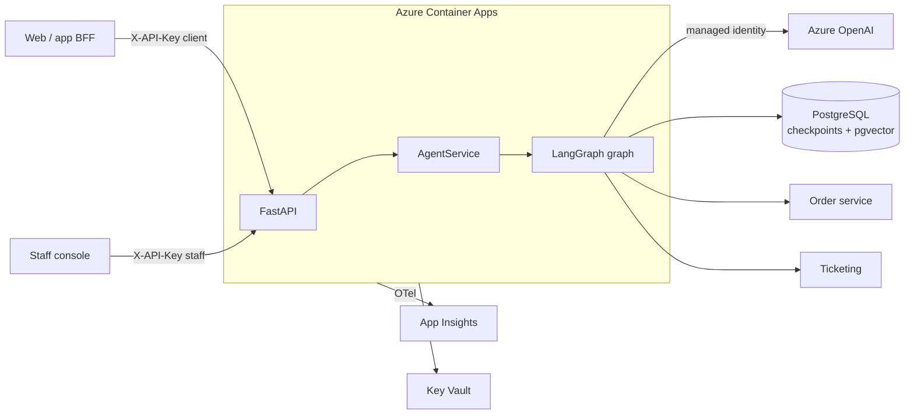

# Support Agent

A production-grade customer support agent for a fictional Indian e-commerce company ("Acme Retail"), built with **LangGraph + FastAPI** and deployed to **Azure Container Apps** with **Azure OpenAI**, **PostgreSQL (pgvector)**, **Key Vault** and **Application Insights**.

It answers policy questions from a knowledge base, looks up orders, issues refunds (with human approval above a threshold), and hands conversations to a human when it isn't sure. Every one of those paths is tested.

```
make install && make test        # 40 tests, < 2s, no network, no API keys
```

---

## What it does

| Customer says | What happens |
|---|---|
| "How many days do I have to return a shirt?" | **Corrective RAG**: hybrid search, then an LLM grades relevance, then the answer is generated and checked for groundedness. Cites its source. |
| "Where is order ORD-1002?" | **Tool-calling agent** calls `lookup_order`. The tool is hard-scoped to the authenticated customer. |
| "Refund ₹40 for ORD-1002, it's broken" | Refund under the ₹50 limit, so it is **auto-approved** and executed. |
| "Refund ORD-1001 in full" | ₹2,499 is over the limit, so the graph **pauses** (`interrupt()`) until a staff member approves or rejects it via the API. |
| "I want to talk to a human" / angry / low confidence | Creates a **ticket**, then pauses until a staff member replies. |
| "Ignore previous instructions and…" | **Blocked by guardrails** before any LLM call. |

## Architecture



The agent graph itself is in [`docs/architecture.md`](docs/architecture.md), rendered from the code by `make graph`.

---

## How to read this codebase

If you're here to learn how production agent services are structured, read in this order:

1. **`src/support_agent/agent/graph.py`**: the whole architecture in about 80 lines. Every node, every edge.
2. **`agent/state.py`**: what is remembered between steps and turns, and why scratch fields reset each turn.
3. **`agent/nodes/`**: one file per capability. Start with `rag.py` (CRAG), then `account.py` (tools and approval), then `handoff.py`, which explains why ticket creation and the pause live in *two* nodes.
4. **`agent/tools.py`**: how `InjectedState` turns "the LLM can't read other customers' orders" from a prompt hope into a code guarantee.
5. **`services/agent_service.py`**: how a graph becomes an API: ownership checks, interrupts mapped to statuses, resume validation, SSE.
6. **`bootstrap.py`**: the composition root, the single place where real and fake implementations are chosen.
7. **`tests/fakes.py`** and **`tests/integration/test_graph_flows.py`**: how the whole graph is tested with no LLM.

## Directory guide (and *why* each part exists)

```
src/support_agent/
├── core/              Cross-cutting plumbing. Knows nothing about agents.
│   ├── config.py        Every setting, typed. Nothing else reads os.environ.
│   ├── logging.py       structlog JSON with request_id/thread_id on every line
│   ├── telemetry.py     OpenTelemetry -> App Insights; a span per graph node
│   ├── errors.py        Domain errors -> one consistent JSON error envelope
│   └── security.py      API-key auth, client vs staff roles, constant-time compare
├── agent/             The LangGraph agent. Knows nothing about HTTP or Azure.
│   ├── graph.py         Assembly: nodes + edges. READ FIRST.
│   ├── state.py         Graph state + per-turn reset
│   ├── edges.py         Routing decisions as pure functions (unit-tested)
│   ├── nodes/           One module per capability, built from injected deps
│   ├── dependencies.py  The DI contract: Runnables + Protocols, not concrete clients
│   ├── tools.py         Tools, customer-scoped via InjectedState
│   ├── policies.py      Business rules (refund approval threshold)
│   ├── guardrails.py    Regex injection detection + PII redaction (Luhn-checked)
│   ├── prompts.py       Prompts as versioned code (PROMPT_VERSION)
│   ├── schemas.py       Structured-output contracts (strict JSON schema)
│   └── messages.py      History shaping/trimming without orphaning tool calls
├── llm/               The ONLY place that knows we use Azure OpenAI
│   ├── factory.py       Entra ID auth, retries, fallback deployment, DI wiring
│   └── errors.py        Content-filter detection
├── rag/               Chunking, hybrid retrieval (vector + full-text + RRF), ingestion
├── integrations/      Downstream services behind Protocols (HTTP client + in-memory fake)
├── persistence/       Connection pool, advisory-locked migrations, SQL files
├── services/          Application layer: the only code that calls the graph
├── api/               Thin FastAPI routes + pure-ASGI request-context middleware
├── bootstrap.py       Composition root: builds every long-lived object once
└── main.py            App factory (no import-time side effects)

tests/                 Unit + integration, fakes via DI (no mocking/patching)
evals/                 Behavioural evals against the REAL model (nightly, not per-PR)
infra/                 Bicep: 7 modules, managed identity everywhere, bootstrap script
.github/workflows/     ci (lint/types/tests/image scan), deploy (OIDC), evals (nightly)
data/knowledge_base/   Help-centre articles that get ingested into pgvector
docs/                  Architecture, deployment, runbook, ADRs
```

**The dependency rule:** `api -> services -> agent -> (llm, rag, integrations, persistence) -> core`. Arrows only point inward and down. That's why the agent can be tested without HTTP, and the API without an LLM.

---

## Quickstart (local)

Prerequisites: Python 3.12, [uv](https://docs.astral.sh/uv/), Docker, and access to an Azure OpenAI resource with a chat deployment and an embedding deployment.

```bash
make install                 # deps + pre-commit hooks
cp .env.example .env         # set AZURE_OPENAI_ENDPOINT (and deployments)
az login                     # Entra ID auth; no API key needed

docker compose up -d db      # Postgres 16 + pgvector
make ingest                  # chunk + embed data/knowledge_base into pgvector
make run                     # http://localhost:8000/docs
```

There's also a no-Postgres mode: set `CHECKPOINTER_BACKEND=memory` and `RETRIEVER_BACKEND=memory`. State is lost on restart, but you only need Azure OpenAI.

### Try it

```bash
# 1) Ask for a big refund -> graph pauses for approval
curl -s localhost:8000/v1/chat -H 'X-API-Key: dev-client-key' -H 'content-type: application/json' \
  -d '{"customer_id":"cust_123","message":"Please refund ORD-1001 in full, the headphones died"}'
# -> {"status":"awaiting_approval","thread_id":"<id>", ...}

# 2) Staff approves -> graph resumes exactly where it stopped, refund executes
curl -s localhost:8000/v1/threads/<id>/resume -H 'X-API-Key: dev-staff-key' -H 'content-type: application/json' \
  -d '{"decision":{"type":"approval","approved":true,"reviewer":"priya"}}'

# 3) Streaming (SSE)
curl -N localhost:8000/v1/chat/stream -H 'X-API-Key: dev-client-key' -H 'content-type: application/json' \
  -d '{"customer_id":"cust_123","message":"What is your return window?"}'
```

Demo customers (in-memory order service): `cust_123` owns `ORD-1001` (₹2,499) and `ORD-1002` (₹40). `cust_999` owns `ORD-2001`. Try asking about it as `cust_123`.

## API

| Method | Path | Role | Purpose |
|---|---|---|---|
| POST | `/v1/chat` | client, staff | Send a message, get `TurnResult` |
| POST | `/v1/chat/stream` | client, staff | Same, as SSE (`start`, `token`*, `final`) |
| GET | `/v1/threads/{id}?customer_id=` | client, staff | Conversation history + pending action |
| POST | `/v1/threads/{id}/resume` | **staff** | Approve or reject an action, or reply to a handed-off customer |
| GET | `/health/live`, `/health/ready` | none | Container Apps probes |

A `TurnResult.status` is one of `completed`, `awaiting_approval` or `awaiting_human`. With SSE, treat `final.reply` as authoritative: a streamed draft can still fail the groundedness check and be replaced by a handoff.

## Testing strategy

| Layer | What it proves | Where | Runs |
|---|---|---|---|
| Unit | Pure logic: guardrails, policies, routing, chunking | `tests/unit` | every PR |
| Graph integration | Every flow end-to-end with fake LLMs, incl. HITL pause/resume | `tests/integration/test_graph_flows.py` | every PR |
| API contract | Auth, roles, error envelope, SSE | `tests/integration/test_api.py` | every PR |
| Checkpoint safety | No custom Python types leak into persisted state | `test_checkpoint_safety.py` | every PR |
| Real Postgres | Migrations, hybrid SQL, resume across "replicas" | `test_postgres.py` | every PR (CI service container) |
| **Evals** | The *model's* behaviour: routing accuracy, answers, escalation, safety | `evals/` | nightly + manual |

Tests check that the graph is *wired* correctly. Evals check that the model *behaves* well inside it. You need both, and you shouldn't make PRs flaky or expensive by running LLM evals on every one.

## Deploying to Azure

See **[docs/deployment.md](docs/deployment.md)**. The short version:

```bash
RG=rg-support-agent-dev LOCATION=centralindia ./infra/scripts/bootstrap.sh
```

After that, every push to `main` goes through CI, then `az acr build`, then a new Container Apps revision, then a readiness check.

## Key design decisions

Recorded as ADRs in [`docs/adr/`](docs/adr):

1. [LangGraph over a hand-rolled agent loop](docs/adr/0001-langgraph.md)
2. [Postgres for checkpoints *and* vectors](docs/adr/0002-postgres-for-everything.md)
3. [Dependency injection for every LLM call](docs/adr/0003-dependency-injection.md)
4. [Auth model: BFF + API keys, tools scoped by injected state](docs/adr/0004-auth-model.md)
5. [Human-in-the-loop via interrupts](docs/adr/0005-human-in-the-loop.md)

## Deliberately out of scope

These are the things a real team would add next. Each is a known gap, not an oversight:

- **Private networking** (VNet + private endpoints for Postgres, OpenAI and Key Vault). The template uses public endpoints with firewall rules to stay readable.
- **Cross-replica turn locking.** The per-thread lock is in-process. Clients must not send concurrent turns for one thread. A Postgres advisory lock per thread would close this gap.
- **Entra ID auth to Postgres** instead of a password in Key Vault.
- **Azure AI Content Safety Prompt Shields** in front of the regex guardrails.
- **A real staff console UI.** The API exists (`/resume`); the frontend doesn't.
- **Rate limiting per customer** (usually done in Azure API Management in front of this service).
