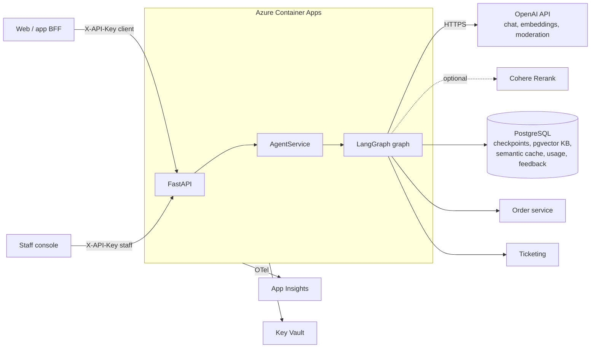

# Support Agent

A production-grade customer support agent for a fictional Indian e-commerce company ("Acme Retail"), built with **LangGraph + FastAPI** on the **OpenAI API**, deployed to **Azure Container Apps** with **PostgreSQL (pgvector)**, **Key Vault** and **Application Insights**.

It answers policy questions from a knowledge base, looks up orders, issues refunds (with human approval above a threshold), and hands conversations to a human when it isn't sure. Around that core sit the production layers: semantic caching, reranking, input and output moderation, PII redaction, per-turn cost tracking and customer feedback.

```
make install && make test        # 64 tests, ~2s, no network, no API keys (69 with Postgres)
```

---

## What it does

| Customer says | What happens |
|---|---|
| "How many days do I have to return a shirt?" | **Semantic cache** check first. On a miss, **Corrective RAG** runs: hybrid search, then **rerank**, then an LLM grades relevance, then the answer is generated and checked for groundedness. The verified answer is cached. |
| Same question again, worded differently | Served from the **semantic cache**: zero generation calls. |
| "Where is order ORD-1002?" | **Tool-calling agent** calls `lookup_order`. The tool is hard-scoped to the authenticated customer. |
| "Refund ORD-1001 in full" | ₹2,499 is over the ₹50 limit, so the graph **pauses** (`interrupt()`) until staff approve or reject it. |
| "I want to talk to a human" / angry / low confidence | Creates a **ticket**, then pauses until a staff member replies. |
| "Ignore previous instructions…" / abusive text | **Blocked** by regex guards and OpenAI **moderation** before any model call. |
| A model answer containing PII, unsafe text or our own prompt | The **output guard** redacts it, or replaces it and escalates. |

Every turn's token usage and cost is recorded, and customers can rate any answer.

## Architecture



The agent graph is in [`docs/architecture.md`](docs/architecture.md), rendered from the code by `make graph`.

---

## How to read this codebase

1. **`AGENTS.md`**: the rules of the repo, and why each exists.
2. **`src/support_agent/agent/graph.py`**: the whole architecture. Every node, every edge.
3. **`agent/state.py`**: what is remembered between steps and turns.
4. **`agent/nodes/`**: one file per capability. `rag.py` (CRAG), `cache.py`, `guard.py` (input + output), `account.py` (tools + approval), `handoff.py`.
5. **`agent/tools.py`**: how `InjectedState` makes "the LLM can't read other customers' orders" a code guarantee.
6. **`services/agent_service.py`**: graph to API: ownership, interrupts, cost tracking, feedback, SSE.
7. **`bootstrap.py`**: the composition root, the one place real or fake implementations are chosen.
8. **`tests/fakes.py`** and **`tests/integration/`**: how the whole graph is tested with no LLM.

## Directory guide (and *why* each part exists)

```
src/support_agent/
├── core/              Cross-cutting plumbing. Knows nothing about agents.
│   ├── config.py        Every setting, typed + validated (fails at boot, not mid-request)
│   ├── logging.py       structlog JSON with request_id/thread_id on every line
│   ├── telemetry.py     OpenTelemetry -> App Insights; a span per graph node
│   ├── errors.py        Domain errors -> one consistent JSON error envelope
│   └── security.py      API-key auth, client vs staff roles, constant-time compare
├── agent/             The LangGraph agent. Knows nothing about HTTP or providers.
│   ├── graph.py         Assembly: nodes + edges. READ FIRST.
│   ├── state.py         Graph state + per-turn reset
│   ├── edges.py         Routing decisions as pure functions (unit-tested)
│   ├── nodes/           guard (in/out), routing, cache, rag, account, handoff
│   ├── dependencies.py  The DI contract: Runnables + Protocols, not concrete clients
│   ├── tools.py         Tools, customer-scoped via InjectedState
│   ├── policies.py      Business rules (refund approval threshold)
│   ├── guardrails.py    Injection regexes, PII redaction (Luhn), prompt-leak detection
│   ├── prompts.py       Prompts as versioned code (PROMPT_VERSION)
│   ├── schemas.py       Structured-output contracts (strict JSON schema)
│   └── messages.py      History shaping/trimming without orphaning tool calls
├── llm/               The ONLY place that knows we use OpenAI
│   ├── factory.py       ChatOpenAI/embeddings, retries, fallback model, DI wiring
│   ├── moderation.py    OpenAI moderation behind a Protocol (fail-open, configurable)
│   ├── usage.py         Token + cost tracking callback, longest-prefix pricing
│   └── errors.py        Provider safety-refusal detection
├── rag/               Chunking, hybrid retrieval (vector + full-text + RRF),
│                      reranking, semantic cache, idempotent ingestion
├── integrations/      Downstream services behind Protocols (HTTP client + in-memory fake)
├── persistence/       Pool, advisory-locked migrations, SQL files, usage/feedback stores
├── services/          Application layer: the only code that calls the graph
├── api/               Thin FastAPI routes + pure-ASGI request-context middleware
├── bootstrap.py       Composition root
└── main.py            App factory (no import-time side effects)

tests/                 Unit + integration + real-Postgres, fakes via DI (no mocking)
evals/                 Behavioural evals against the REAL model (nightly, not per-PR)
infra/                 Bicep: 6 modules, managed identity, secrets in Key Vault
.github/workflows/     ci (lint/types/tests/image scan), deploy (OIDC), evals (nightly)
data/knowledge_base/   Help-centre articles ingested into pgvector
docs/                  Architecture, deployment, runbook, ADRs
AGENTS.md, CLAUDE.md   Instructions for AI coding agents working in this repo
```

**The dependency rule:** `api -> services -> agent -> (llm, rag, integrations, persistence) -> core`. Arrows only point inward.

---

## Quickstart (local)

Prerequisites: Python 3.12, [uv](https://docs.astral.sh/uv/), Docker, and an OpenAI API key (ideally project-scoped, with a budget limit).

```bash
make install                 # deps + pre-commit hooks
cp .env.example .env         # set OPENAI_API_KEY
docker compose up -d db      # Postgres 16 + pgvector
make ingest                  # chunk + embed data/knowledge_base into pgvector
make run                     # http://localhost:8000/docs
```

There's also a no-Postgres mode: set `CHECKPOINTER_BACKEND=memory` and `RETRIEVER_BACKEND=memory`. State is lost on restart; you only need the OpenAI key.

### Try it

```bash
# 1) Big refund -> graph pauses for approval
curl -s localhost:8000/v1/chat -H 'X-API-Key: dev-client-key' -H 'content-type: application/json' \
  -d '{"customer_id":"cust_123","message":"Please refund ORD-1001 in full, the headphones died"}'

# 2) Staff approves -> graph resumes exactly where it stopped
curl -s localhost:8000/v1/threads/<thread_id>/resume -H 'X-API-Key: dev-staff-key' -H 'content-type: application/json' \
  -d '{"decision":{"type":"approval","approved":true,"reviewer":"priya"}}'

# 3) Ask an FAQ twice from fresh threads; the second reply has "cached": true
curl -s localhost:8000/v1/chat -H 'X-API-Key: dev-client-key' -H 'content-type: application/json' \
  -d '{"customer_id":"cust_123","message":"What is your return window?"}'

# 4) Rate the answer (reply_message_id comes from the chat response)
curl -s localhost:8000/v1/threads/<thread_id>/feedback -H 'X-API-Key: dev-client-key' -H 'content-type: application/json' \
  -d '{"customer_id":"cust_123","message_id":"<reply_message_id>","rating":"up"}'
```

Demo customers (in-memory order service): `cust_123` owns `ORD-1001` (₹2,499) and `ORD-1002` (₹40). `cust_999` owns `ORD-2001`.

## API

| Method | Path | Role | Purpose |
|---|---|---|---|
| POST | `/v1/chat` | client, staff | Send a message, get a `TurnResult` |
| POST | `/v1/chat/stream` | client, staff | Same, as SSE (`start`, `token`*, `final`) |
| GET | `/v1/threads/{id}?customer_id=` | client, staff | Conversation history (with message ids) + pending action |
| POST | `/v1/threads/{id}/feedback` | client, staff | Thumbs up/down on one assistant message (upsert) |
| POST | `/v1/threads/{id}/resume` | **staff** | Approve or reject an action, or reply to a handed-off customer |
| GET | `/health/live`, `/health/ready` | none | Container Apps probes |

`TurnResult.status` is one of `completed`, `awaiting_approval` or `awaiting_human`. With SSE, treat `final.reply` as authoritative: a streamed draft can still be rejected by the groundedness check or the output guard.

## Production features

| Feature | Where | Key decision |
|---|---|---|
| Semantic cache | `rag/semantic_cache.py`, `nodes/cache.py` | FAQ only, first turn only, verified answers only; namespaced by prompt version + model; wiped on KB change. Threshold 0.95 |
| Reranking | `rag/reranker.py` | Retrieve 20, rerank to 5 with a cross-encoder (Cohere). Optional; degrades to RRF order on failure |
| Input moderation | `nodes/guard.py` | Cheapest first: length, regex, then OpenAI moderation |
| Output guard | `nodes/guard.py` | Prompt-leak detection (8-word shingles), moderation, PII redaction. Unsafe answers are *replaced in state*, not just hidden |
| Cost tracking | `llm/usage.py` | Callback sums tokens per model per turn; cost via configurable price table; persisted to `llm_usage` |
| Feedback | `POST /feedback` | One vote per message (upsert), tagged with `PROMPT_VERSION` |
| Model fallback | `llm/factory.py` | Retries, then `OPENAI_FALLBACK_MODEL`, then a retryable 503 |

## Testing strategy

| Layer | What it proves | Where | Runs |
|---|---|---|---|
| Unit | Guardrails, policies, routing, chunking, pricing, HTTP clients | `tests/unit` | every PR |
| Graph integration | Every flow end-to-end with fake LLMs, incl. HITL, cache, guards | `tests/integration/test_graph_flows.py`, `test_production_features.py` | every PR |
| API contract | Auth, roles, error envelope, SSE, feedback | `tests/integration/test_api.py` | every PR |
| Checkpoint safety | No custom Python types leak into persisted state | `test_checkpoint_safety.py` | every PR |
| Real Postgres | Migrations, hybrid SQL, cache SQL, usage/feedback, resume across "replicas" | `test_postgres.py` | every PR (CI service container) |
| **Evals** | The *model's* behaviour | `evals/` | nightly + manual |

## Deploying to Azure

See **[docs/deployment.md](docs/deployment.md)**:

```bash
export OPENAI_API_KEY=sk-proj-...
RG=rg-support-agent-dev LOCATION=centralindia ./infra/scripts/bootstrap.sh
```

After that, every push to `main` goes through CI, then `az acr build`, then a new revision, then a readiness check.

## Key design decisions

Recorded as ADRs in [`docs/adr/`](docs/adr):

1. [LangGraph over a hand-rolled agent loop](docs/adr/0001-langgraph.md)
2. [Postgres for checkpoints *and* vectors](docs/adr/0002-postgres-for-everything.md)
3. [Dependency injection for every LLM call](docs/adr/0003-dependency-injection.md)
4. [Auth model: BFF + API keys, tools scoped by injected state](docs/adr/0004-auth-model.md)
5. [Human-in-the-loop via interrupts](docs/adr/0005-human-in-the-loop.md)
6. [OpenAI API as the model provider](docs/adr/0006-openai-provider.md)
7. [Semantic cache correctness rules](docs/adr/0007-semantic-cache.md)

## Deliberately out of scope

Each is a known gap, not an oversight:

- **Private networking** (VNet + private endpoints for Postgres and Key Vault). Public endpoints with firewall rules keep the template readable.
- **Cross-replica turn locking.** The per-thread lock is in-process. A Postgres advisory lock per thread would close this gap.
- **Entra ID auth to Postgres** instead of a password in Key Vault.
- **Embedding cost** isn't tracked (embedding calls emit no LLM callbacks). At $0.02 per 1M tokens it's small, but a wrapper would make it exact.
- **Online quality dashboards.** Feedback and usage are persisted and logged; the dashboards and alerts on top are documented in the runbook but not provisioned.
- **A staff console UI.** The API exists; the frontend doesn't.
- **Per-customer rate limiting** (usually done in Azure API Management in front of this service).
