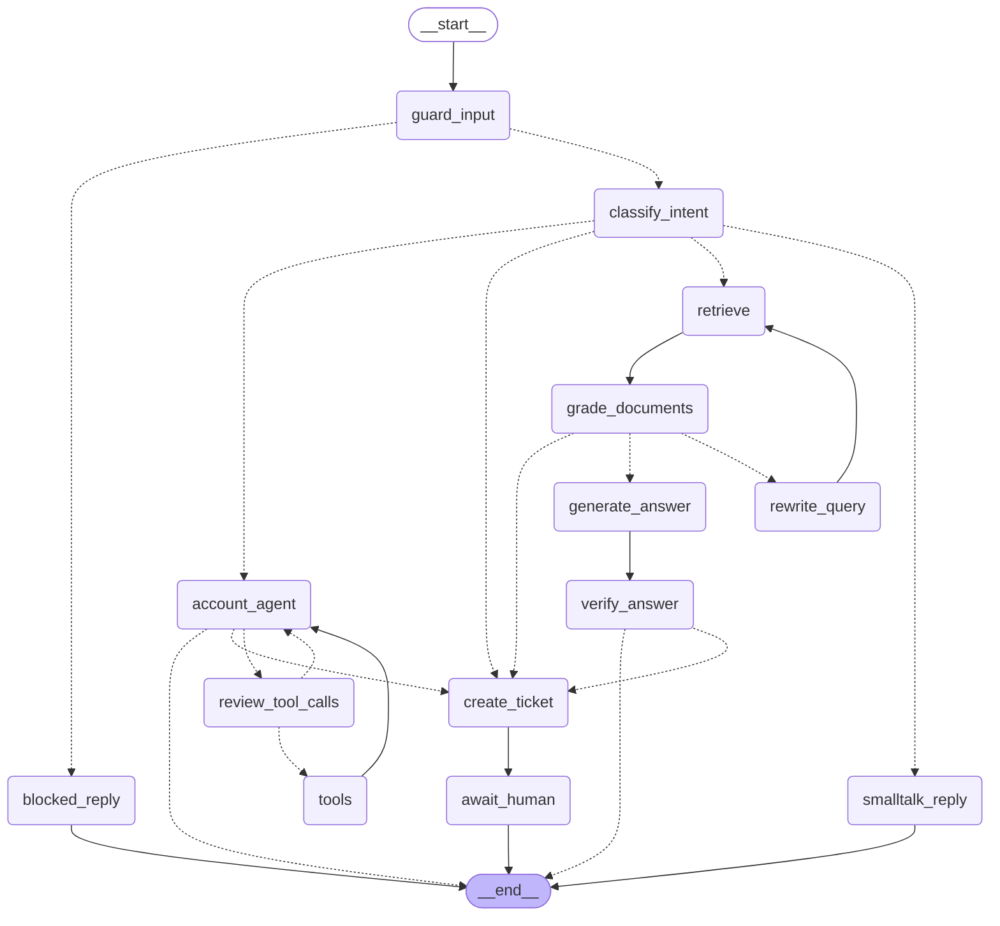

# Architecture

## The agent graph

Rendered from the compiled graph (`make graph` regenerates `docs/graph.mmd`). Dashed edges are conditional.

## Request lifecycle: one customer turn

1. **Middleware** assigns or propagates `X-Request-ID` and binds it to every log line.
2. **Auth** (`core/security.py`) resolves the API key to a `client` or `staff` principal.
3. **`AgentService.chat`**
   - takes the in-process per-thread lock;
   - loads the checkpoint and verifies the thread belongs to this `customer_id` (403 otherwise);
   - refuses new messages while the thread is paused on an interrupt (409);
   - invokes the graph with `new_turn(...)`: the new message plus a reset of per-turn scratch fields.
4. **Graph**
   - `guard_input`: length limit and regex injection check. No LLM is called yet.
   - `classify_intent`: structured output `IntentDecision`. Confidence below the threshold, or intent `human`, goes to handoff.
   - One branch runs (see below). The checkpoint is written to Postgres after **every** node.
5. **Result mapping.** If the graph is paused on an `interrupt`, the status is `awaiting_approval` or `awaiting_human` and the reply is the interrupt's `customer_message`. Otherwise the status is `completed` and the reply is the last AI message.

## The four branches

### FAQ: Corrective RAG
`retrieve` -> `grade_documents` -> (`rewrite_query` -> `retrieve`)at most once -> `generate_answer` -> `verify_answer`

- **Hybrid retrieval** (`rag/retriever.py`): pgvector cosine search and Postgres full-text search, each takes the top 20, fused with Reciprocal Rank Fusion (k=60). Dense search misses exact tokens like "COD" or "ORD-1001"; lexical search misses paraphrases. RRF needs no score calibration between the two.
- **Grading**: an LLM judge keeps only documents that actually answer the question. Irrelevant context is the top cause of confident wrong answers.
- **Bounded rewrite**: one retry with a reformulated query, then escalate. No infinite loops.
- **Groundedness check**: the draft is verified against the context before it is shown. If it fails, the conversation goes to handoff.

### Account: tool calling with approval
`account_agent` <-> `review_tool_calls` <-> `tools`

- Tools receive `customer_id` via `InjectedState`. It isn't in the tool schema the LLM sees, so the model can't be talked into querying another customer.
- `review_tool_calls` applies `policies.requires_approval`. Refunds over `REFUND_AUTO_APPROVE_LIMIT` call `interrupt()`.
- On rejection, a `ToolMessage` is written for **every** pending tool call (the OpenAI API requires this), and control returns to the agent so it can explain.
- `issue_refund` uses the `tool_call_id` as its idempotency key. That id is stable across replays, so a retried refund can't double-pay.
- `max_tool_iterations` caps tool loops. Hitting the cap goes to handoff.

### Smalltalk
A single cheap reply.

### Handoff
`create_ticket` -> `await_human`

Two nodes on purpose: `interrupt()` re-runs its whole node on resume, so the side effect (the ticket) must happen in an earlier node. The ticket call also carries an idempotency key as a second safeguard.

## State design

| Field | Lifetime | Notes |
|---|---|---|
| `messages` | conversation | `add_messages` reducer |
| `customer_id` | conversation | ownership + tool scoping |
| `audit_log` | conversation | append-only (`operator.add`): approvals, handoffs, guardrail blocks |
| `intent`, `query`, `documents`, `draft_answer`, `rewrite_count`, `tool_iterations`, `handoff_reason`, `ticket_id`, `guardrail_violation` | **one turn** | reset by `new_turn()` |

**Rule:** state holds only JSON-ish primitives and LangChain messages. Enums are stored as their `.value`. Custom types in checkpoints break when LangGraph tightens deserialisation, and would strand every paused conversation. `test_checkpoint_safety.py` enforces this, and production runs with `LANGGRAPH_STRICT_MSGPACK=true`.

## Failure handling

| Failure | Behaviour |
|---|---|
| Azure OpenAI 429/5xx/timeout | SDK retries with backoff, then the fallback deployment (if configured), then **503** `service_unavailable`. The checkpoint is intact, so the client can retry. |
| Azure content filter (400) | Routed to human handoff, not a 500 |
| Retriever error | Logged; treated as "no documents", which leads to rewrite and then handoff |
| Order service / ticketing outage | Jittered exponential retries (5xx/429/transport only), then 502 `upstream_error` |
| Refund business-rule violation | Returned to the LLM as a tool error so it can explain to the customer |
| Replica dies mid-approval | Nothing is lost. The interrupt is in Postgres; any replica can resume it (tested). |
