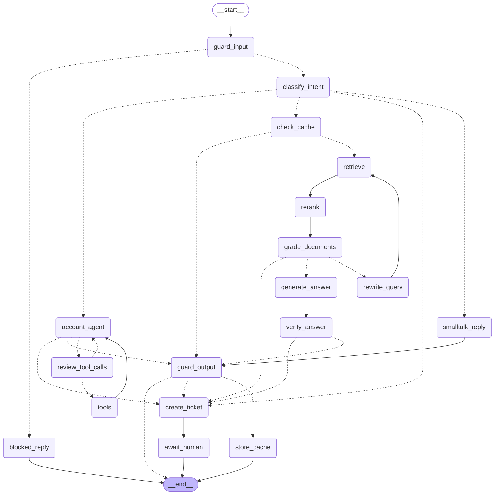

# Architecture

## The agent graph

Rendered from the compiled graph (`make graph` regenerates `docs/graph.mmd`). Dashed edges are conditional.

## Request lifecycle: one customer turn

1. **Middleware** assigns or propagates `X-Request-ID` and binds it to every log line.
2. **Auth** (`core/security.py`) resolves the API key to a `client` or `staff` principal.
3. **`AgentService`** takes the per-thread lock, checks ownership (403) and pending interrupts (409), and attaches a fresh **`UsageTracker`** callback.
4. **Graph**
   - `guard_input`: length limit, regex injection check, then OpenAI moderation. Cheapest first.
   - `classify_intent`: structured `IntentDecision`. Low confidence or `human` goes to handoff.
   - One branch runs (below). Every customer-facing LLM answer then passes **`guard_output`**. The checkpoint is written to Postgres after every node.
5. **Usage** for the turn (tokens and cost per model) is logged, put on the trace span, and written to `llm_usage`.
6. **Result mapping.** Paused on an interrupt means `awaiting_approval` or `awaiting_human`; otherwise `completed`, with `reply_message_id` (for feedback) and `cached`.

## The branches

### FAQ: semantic cache, then Corrective RAG
`check_cache` -> (hit) `guard_output` -> END
`check_cache` -> (miss) `retrieve` -> `rerank` -> `grade_documents` -> (`rewrite_query` -> `retrieve`)at most once -> `generate_answer` -> `verify_answer` -> `guard_output` -> `store_cache`

- **Semantic cache** (`rag/semantic_cache.py`): see ADR 0007 for the seven correctness rules (FAQ only, first turn only, vetted answers only, 0.95 threshold, namespaced, TTL + wipe on ingest, never fails a turn).
- **Hybrid retrieval**: pgvector cosine plus Postgres full-text, fused with RRF (k=60).
- **Rerank**: with `RERANKER_BACKEND=cohere`, retrieve 20 and keep the best 5 by cross-encoder score; on any reranker failure, keep RRF order. With `none`, the retriever returns 5 and the node passes them through.
- **Grading**, a **bounded rewrite**, and a **groundedness check** before anything is shown.

### Account: tool calling with approval
`account_agent` <-> `review_tool_calls` <-> `tools`, then `guard_output`

- `customer_id` reaches tools via `InjectedState`; the model never sees it.
- Refunds over `REFUND_AUTO_APPROVE_LIMIT` call `interrupt()`. Rejection writes a `ToolMessage` for every pending call.
- `tool_call_id` is the refund idempotency key. `max_tool_iterations` caps loops.

### Smalltalk
`smalltalk_reply` -> `guard_output`.

### Handoff
`create_ticket` -> `await_human`. Two nodes, because `interrupt()` re-runs its node on resume.

## The output guard

Runs on every LLM-written answer before the turn ends, in this order:

1. **Prompt-leak check:** any 8-word run of a system prompt in the answer means it is replaced and escalated.
2. **Moderation** (OpenAI `omni-moderation-latest`): flagged means replaced and escalated.
3. **PII redaction:** emails, Indian phone numbers, Luhn-valid card numbers become `[EMAIL]`, `[PHONE]`, `[CARD]`.

Replacement reuses the message **id**, so the `add_messages` reducer overwrites the unsafe message in state instead of appending. It never reaches the checkpoint, the thread history or the cache.

## State design

| Field | Lifetime | Notes |
|---|---|---|
| `messages` | conversation | `add_messages` reducer (append, replace by id) |
| `customer_id` | conversation | ownership + tool scoping |
| `audit_log` | conversation | append-only: approvals, handoffs, guard blocks/redactions |
| `intent`, `query`, `documents`, `draft_answer`, `rewrite_count`, `tool_iterations`, `handoff_reason`, `ticket_id`, `guardrail_violation`, `cacheable`, `cache_hit`, `output_modified` | **one turn** | reset by `new_turn()` |

**Rule:** state holds only JSON-like primitives and LangChain messages. Enums are stored as `.value`. `test_checkpoint_safety.py` enforces it, and production runs with `LANGGRAPH_STRICT_MSGPACK=true`.

## Failure handling

| Failure | Behaviour |
|---|---|
| OpenAI 429/5xx/timeout | SDK retries with backoff, then `OPENAI_FALLBACK_MODEL` (if set), then **503** `service_unavailable`. The checkpoint is intact. |
| Provider safety refusal (400) | Routed to human handoff, not a 500 |
| Moderation endpoint down | **Fail-open** with an error log (configurable to fail-closed); other guards still apply |
| Reranker down | Logged; RRF order kept |
| Semantic cache down | Logged; full RAG pipeline runs |
| Usage / feedback write fails | Logged; the turn still succeeds |
| Retriever error | Treated as "no documents", which leads to rewrite and then handoff |
| Order service / ticketing outage | Jittered retries (5xx/429/transport only), then 502 `upstream_error` |
| Replica dies mid-approval | Nothing lost; any replica can resume (tested) |
